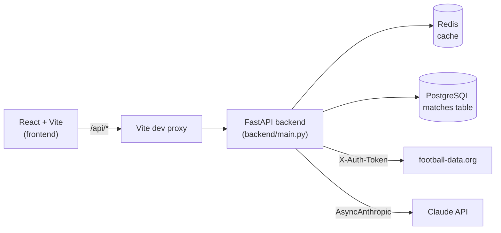
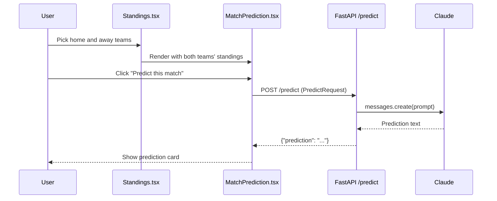

PitchIQ is a live soccer analytics dashboard. A React frontend talks to a FastAPI backend, which pulls live data from [football-data.org](https://www.football-data.org), caches it in Redis, stores local matches in PostgreSQL, and asks Claude for match predictions.

## Architecture



The browser never calls football-data.org or Claude directly. FastAPI sits in the middle so API keys stay on the server and responses can be validated, filtered, and cached.

### Services

`docker-compose.yml` runs four containers:

| Service | Image / build | Port | Role |
|---|---|---|---|
| `db` | `postgres:16` | `5433` → `5432` | Stores locally created matches. Has a `pg_isready` healthcheck. |
| `redis` | `redis:7` | `6379` | Caches football-data.org responses. |
| `backend` | `backend/Dockerfile` | `8000` | FastAPI app. Waits for `db` to be healthy and `redis` to start. |
| `frontend` | `frontend/Dockerfile` | `5173` | React + TypeScript + Vite dashboard. |

### Backend modules

| File | Responsibility |
|---|---|
| `backend/main.py` | Creates the FastAPI app, CORS, startup lifespan, error handlers, and all endpoints. |
| `backend/football.py` | The football-data.org client, Redis cache helpers, and the list of supported competitions. |
| `backend/predict.py` | Builds the prediction prompt and calls Claude. |
| `backend/database.py` | SQLAlchemy `engine`, `SessionLocal`, `Base`, and the `get_db()` dependency. |
| `backend/models.py` | The `Match` table definition. |
| `backend/schemas.py` | Pydantic schemas: `MatchCreate`, `MatchResponse`, and `PredictRequest`. |

### Frontend data flow

Components never make HTTP requests themselves. They call functions in `frontend/src/api/football.ts` (for example `getStandings`, `getTopScorers`, `getLiveMatches`, `predictMatch`), which use axios to call `/api/...`. The Vite dev server proxies `/api` to the backend (`VITE_API_URL`, or `http://localhost:8000` by default) and strips the `/api` prefix.

### Startup and failure behavior

The backend is designed to keep running when a dependency is down:

- **Startup:** the `lifespan` function creates database tables with `Base.metadata.create_all()`. If Postgres is unreachable, it logs an error and starts anyway. It also logs a warning (name only, never the value) if `FOOTBALL_API_KEY` or `ANTHROPIC_API_KEY` is missing.
- **Postgres down:** any SQLAlchemy `OperationalError` is turned into a `503` by the `database_unavailable` handler. Football pages keep working.
- **Redis down:** caching is skipped and data comes straight from football-data.org. See [Redis caching](#redis-caching).
- **Missing keys:** football endpoints and `/predict` return `503` with a "not configured" message.

### Environment variables

| Variable | Used by | Default |
|---|---|---|
| `DATABASE_URL` | `database.py` | `postgresql://localhost/pitchiq` |
| `REDIS_HOST` | `football.py` | `localhost` (`redis` in Docker) |
| `FOOTBALL_API_KEY` | `football.py` | none |
| `FOOTBALL_API_BASE_URL` | `football.py` | `https://api.football-data.org/v4` (the end-to-end tests point this at a fake server) |
| `ANTHROPIC_API_KEY` | `predict.py` | none |
| `VITE_API_URL` | `frontend/vite.config.ts` | `http://localhost:8000` |

## Backend API endpoints

All endpoints are defined in `backend/main.py`.

### Local database

These read and write the `matches` table in PostgreSQL through a session injected by `Depends(get_db)`.

| Method | Path | Description |
|---|---|---|
| `GET` | `/` | Health check. Returns `{"message": "PitchIQ API is running"}`. |
| `GET` | `/matches` | Returns every row in `matches` as a list of `MatchResponse`. |
| `GET` | `/matches/{match_id}` | Returns one match, or `404` if it does not exist. |
| `POST` | `/matches` | Creates a match from a `MatchCreate` body (`home_team`, `away_team`). Scores default to `0`, status to `scheduled`. |

A `Match` row has `id`, `home_team`, `away_team`, `home_score`, `away_score`, `status`, and `created_at`.

### Live football data

These proxy football-data.org and cache the result in Redis. Each handler receives the Redis client through `Depends(get_cache)`.

| Method | Path | Query / path params | Description |
|---|---|---|---|
| `GET` | `/football/matches` | `competition` (default `PL`) | Matches for a competition. |
| `GET` | `/football/standings` | `competition` (default `PL`) | League table. |
| `GET` | `/football/scorers` | `competition` (default `PL`) | Top scorers. |
| `GET` | `/football/live` | none | All live matches across competitions, with stale matches removed. |
| `GET` | `/football/matches/{match_id}` | `match_id` | Full details for one match. |
| `GET` | `/football/teams/{team_id}` | `team_id` | Team info and squad. |

`competition` is typed as the `Competition` literal in `football.py`, so FastAPI rejects anything else with a `422`. Codes are case-sensitive:

`PL`, `ELC`, `BL1`, `SA`, `PD`, `FL1`, `DED`, `PPL`, `BSA`, `CL`, `EC`, `WC`

#### Error mapping

Every upstream call goes through `fetch_from_api()`, which translates football-data.org responses before anything is cached:

| Upstream result | PitchIQ response |
|---|---|
| `200` | Data is returned (and then cached by the caller). |
| `429` rate limit | `503` with a `Retry-After` header copied from `X-RequestCounter-Reset`. |
| `403` | `403`: competition is not on the data plan. |
| `400` or `404` | `404 Not found.` |
| Other status | `502` |
| Timeout (10 seconds) | `504` |
| Network error | `502` |
| `FOOTBALL_API_KEY` missing | `503` |

Because errors are raised as `HTTPException`, the caching code after the fetch never runs, so error responses are never cached.

### AI predictions

| Method | Path | Description |
|---|---|---|
| `POST` | `/predict` | Generates a Claude match prediction. Returns `{"prediction": "<text>"}`. |

See [AI match predictions](#ai-match-predictions) for the request body and flow.

## Redis caching

football-data.org has rate limits, so the backend caches every successful response in Redis. The logic lives in `backend/football.py`.

### How a request is served

Each football function follows the same cache-aside pattern:

1. Build a cache key, such as `standings:PL`.
2. Call `get_cached()`. On a hit, return the stored JSON immediately.
3. On a miss, call `fetch_from_api()`.
4. Store the result with `set_cached()` using a TTL, then return it.

```python
async def get_standings(cache, competition="PL"):
    cache_key = f"standings:{competition}"
    cached_data = get_cached(cache, cache_key)
    if cached_data:
        return cached_data
    data = await fetch_from_api(f"{BASE_URL}/competitions/{competition}/standings")
    set_cached(cache, cache_key, data)
    return data
```

Values are stored as JSON strings (`json.dumps`) and parsed back with `json.loads`.

### Keys and TTLs

| Endpoint | Cache key | TTL |
|---|---|---|
| `/football/matches` | `matches:{competition}` | 60 seconds |
| `/football/standings` | `standings:{competition}` | 60 seconds |
| `/football/scorers` | `scorers:{competition}` | 60 seconds |
| `/football/live` | `live:matches` | 30 seconds |
| `/football/matches/{id}` | `match:{id}` | Depends on match status (below) |
| `/football/teams/{id}` | `team:{id}` | 12 hours |

Single matches use `match_cache_seconds(status)`:

- `FINISHED`: 24 hours, since the result will not change.
- `IN_PLAY` or `PAUSED`: 30 seconds.
- Anything else (scheduled, postponed): 5 minutes.

### Stale live matches

The free football-data.org plan sometimes leaves a match marked `IN_PLAY` for hours. Before caching `/football/live`, `is_stale()` drops a match if either:

- it kicked off more than 3 hours ago (`LIVE_MATCH_MAX_AGE`), or
- its `lastUpdated` time is earlier than its kickoff.

### Failing open

Redis only makes things faster, so it never breaks a request:

- The client is built by `make_redis_client()` with 1-second connect and socket timeouts and no retries, so a dead Redis does not slow every request down.
- `get_cached()` and `set_cached()` catch `redis.RedisError`, log a warning, and continue. A failed read acts as a cache miss.

<Tip>
`get_cache()` is a FastAPI dependency, so tests can replace Redis with a fake or a broken client through `app.dependency_overrides`.
</Tip>

## AI match predictions

Predictions use Claude (`claude-sonnet-4-6`) with real standings data as context.

### End-to-end flow



1. In `Standings.tsx`, the user selects a home team and an away team from the current league table. The prediction component only appears once both are picked.
2. `MatchPrediction.tsx` sends both teams' position, points, and goal difference, plus the competition name and current matchday, through `predictMatch()` in `api/football.ts`.
3. FastAPI validates the body against `PredictRequest`.
4. `get_prediction()` in `predict.py` builds a prompt and calls Claude.
5. The text of Claude's first content block is returned as `prediction`.

### Request body

```json
{
  "home_team": "Arsenal FC",
  "away_team": "Chelsea FC",
  "competition": "Premier League",
  "home_position": 1,
  "away_position": 4,
  "home_points": 30,
  "away_points": 24,
  "home_gd": 18,
  "away_gd": 9,
  "matchday": 12
}
```

Validation rules from `PredictRequest`:

- `home_position`, `away_position`, and `matchday` must be at least `1`.
- `home_points` and `away_points` must be at least `0`.
- Goal difference can be negative.

An invalid body returns `422` and Claude is never called.

### The prompt

`get_prediction()` asks Claude to act as an expert football analyst and, using the standings data, return:

1. Who will win and why
2. A predicted score
3. One key factor that could decide the match
4. A confidence level: Low, Medium, or High

The answer is capped at about 150 words in the prompt and 300 tokens via `max_tokens`.

### Client and errors

- `get_claude_client()` is a FastAPI dependency. It returns `503` if `ANTHROPIC_API_KEY` is not set. Otherwise it returns an `AsyncAnthropic` client, created once and reused thanks to `@lru_cache`.
- The call is awaited, so a slow Claude response does not block other requests.
- Any `anthropic.AnthropicError` (rate limit, overload, timeout, bad key) is logged on the server and returned to the user as a clean `503`: "Predictions are unavailable right now."
- Predictions are not cached; each click makes a new Claude call.

<Tip>
Tests override `get_claude_client` with a fake client, so the test suite never calls the real Claude API.
</Tip>
